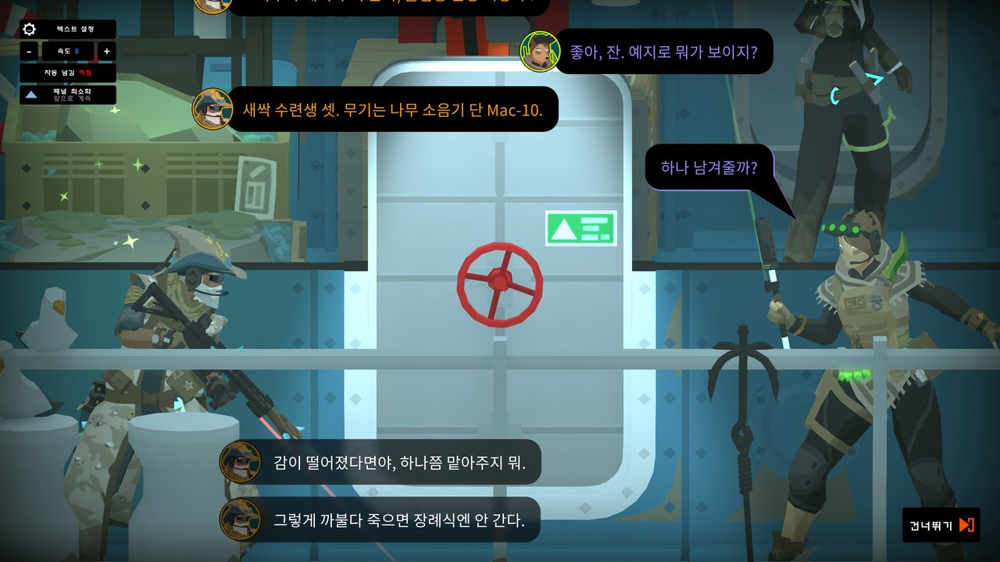
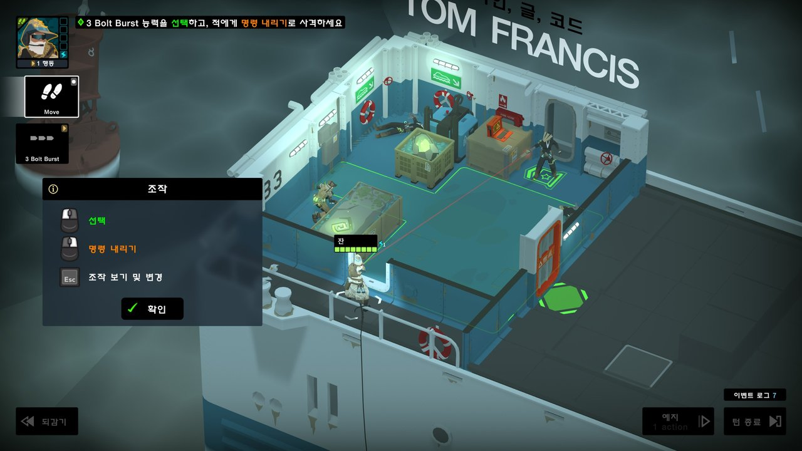
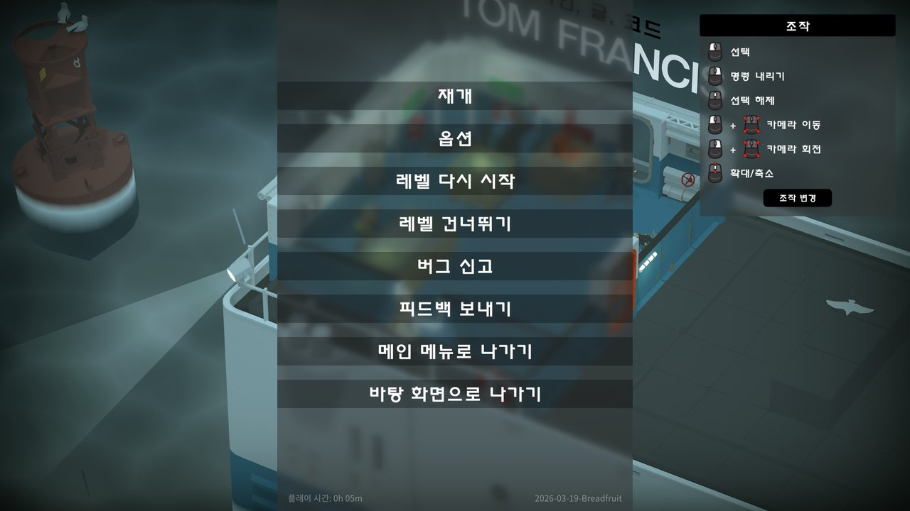
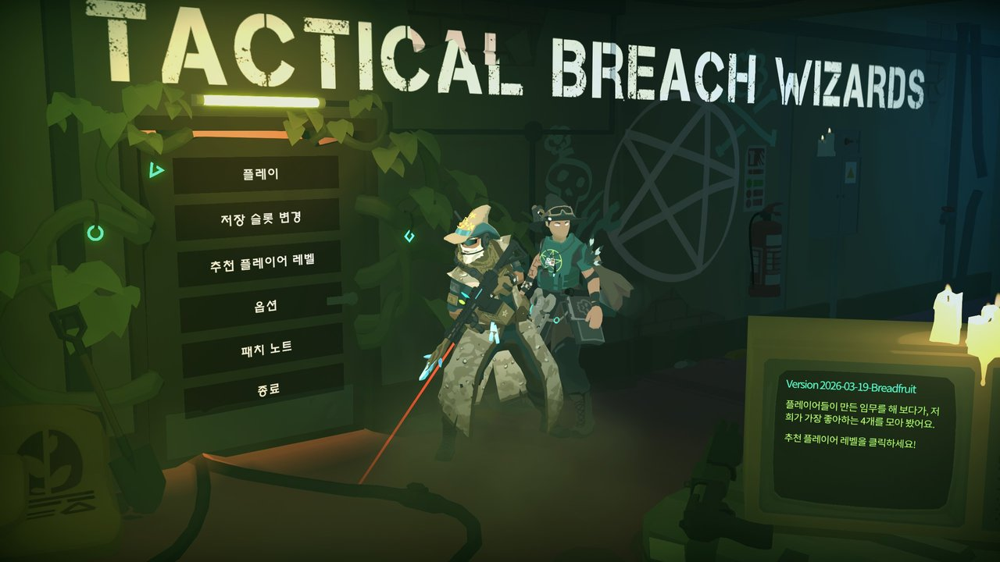

# Tactical Breach Wizards 비공식 한국어 패치

Steam판 [Tactical Breach Wizards](https://store.steampowered.com/app/1043810/)를 한국어로 즐길 수 있게 해 주는 비공식 팬 번역 패치입니다.



> 개발사 Suspicious Developments와 관계없는 **비공식 팬 번역**입니다.
> 무료로 배포되며, 판매하거나 후원을 받는 데 쓸 수 없습니다.

## 먼저 읽어 주세요

**욕설이 나옵니다.** 원작 대사에도 욕설이 있어서, 캐릭터의 말맛을 살리려고 원문 수위 그대로 옮겼습니다. 원문보다 세게 바꾸지는 않았습니다.

**아래는 빠뜨린 게 아니라 일부러 영어로 두었습니다.** 오역·누락 제보 전에 한 번 확인해 주세요.

| 영어로 남은 것 | 이유 |
| --- | --- |
| 능력·특성의 고유 이름 | 공략·위키·커뮤니티에서 쓰는 이름과 맞춰 찾기 쉽게 하려고 남겼습니다. 설명문은 번역되어 있습니다. |
| 적 병종·유닛 이름 | 게임이 이 이름으로 적의 행동 순서를 정합니다. 바꾸면 턴 순서가 원본과 달라질 수 있습니다. |
| 마법사 직업명 Navy Seer, Freelance Witch | 적 병종 이름과 같은 데이터 칸을 써서 같은 이유로 남겼습니다. |
| 게임 안 업데이트 내역, 제작진 이름 | 기록·고유명사라 원문 그대로 두었습니다. |
| 게임이 영어 단어를 이어 붙여 만드는 일부 문장 | 단어를 하나씩 바꾸면 어순이 깨져 오히려 읽기 어려워집니다. |

이 밖에 영어가 보이면 [Issues](../../issues)에 스크린샷과 함께 알려 주세요.

## 받기

[Releases](../../releases/latest)에서 `TBW_KR_Patcher_v1.0.0.exe`를 받으세요. 실행 파일 하나에 번역 데이터가 모두 들어 있습니다.

## 설치

1. 게임을 종료합니다.
2. `TBW_KR_Patcher_v1.0.0.exe`를 실행합니다.
   게임 폴더는 자동으로 찾습니다. 못 찾으면 Steam에서 게임 → 관리 → 로컬 파일 보기로 연 폴더를 창에 끌어다 놓고 Enter를 누르세요.
3. `1`(설치)을 고르고 `Y`를 누릅니다.

- **다른 한글패치(예: 예전 `TBW_KR_Patcher.exe`)를 쓴 적이 있다면** 먼저 Steam에서 게임 → 속성 → 설치된 파일 → **게임 파일 무결성 확인**을 해 주세요. 이미 한국어로 바뀐 파일을 원본으로 백업하지 않도록, 패처가 이를 알아채면 설치를 멈춥니다.
- 처음 설치할 때 원본 파일을 게임 폴더 안 `TBW_KR_Backup` 폴더에 백업합니다. (약 480MB)
- **새 버전으로 업데이트**할 때는 새 패처를 실행해 `1`번을 고르면 됩니다. 무결성 확인은 필요 없습니다.
- **게임이 업데이트되어 영어로 돌아갔다면** 패처를 다시 실행하세요. 업데이트로 바뀐 문장만 영어로 남고 나머지는 다시 적용됩니다.

## 되돌리기

패처를 실행해 `2`번을 고르면 원래 영어 상태로 돌아가고 백업 폴더도 지워집니다.
Steam의 **게임 파일 무결성 확인**으로도 되돌릴 수 있습니다.

## 번역 범위

- 스토리 대사, 전투 대사와 임무 목표, 지도 메모
- 메뉴, 설정, 특성, 조작 설정, 저장 슬롯 등 화면 문구
- 한국어 글꼴 (Noto Sans KR, 부산체 기반)

<p>
  
  
</p>
<p>
  
</p>

## 자주 묻는 질문

**"Windows의 PC 보호" 창이 떠요.**
서명되지 않은 프로그램이라 뜨는 경고입니다. `추가 정보` → `실행`을 누르세요.
받은 파일이 바뀌지 않았는지는 PowerShell에서 `Get-FileHash .\TBW_KR_Patcher_v1.0.0.exe`로 확인할 수 있습니다.

```
SHA-256: 5081c856a01ac289b9306ad2f4d57b63a1499b457770e5db96b7f1c272b88b59
```

**패처가 무엇을 하나요?**
게임 폴더의 데이터 파일과 `Assembly-CSharp.dll` 안의 영어 문장을 한국어로 바꾸고, 한국어 글꼴을 넣습니다.
인터넷에 접속하지 않으며, 게임 폴더 밖의 파일은 건드리지 않습니다. 소스 코드는 [`src/`](src/)에 있습니다.

**게임이 실행 중이라고 나와요.**
게임을 완전히 끈 뒤 Enter를 누르면 이어서 진행합니다.

**버전 번호는 어떻게 붙이나요?**
오역·문구 수정은 `v1.0.1`처럼 끝자리, 번역 범위나 패처 기능이 늘면 `v1.1.0`처럼 가운데 자리, 게임 대형 업데이트 대응처럼 크게 바뀌면 `v2.0.0`처럼 앞자리를 올립니다.

## 오역·버그 제보

[Issues](../../issues)에 남겨 주세요. 스크린샷과 함께 어느 화면이었는지 알려 주시면 고치기 쉽습니다.

## 크레딧

- **원본 번역**: DC인사이드 인디 게임 마이너 갤러리 **김하너** 님과 지인분의 「택티컬 브리치 위저드 "대사만" 한글패치」 ([원문 게시글](https://gall.dcinside.com/mgallery/board/view/?id=indiegame&no=160144))
  이 패치는 그 번역을 바탕으로 문장을 다듬고, 화면 문구 번역과 새 패처를 더한 것입니다.
- **번역 수정 · 패처**: [LemoNadeNade](https://github.com/LemoNadeNade)
- **글꼴**: Noto Sans KR (SIL Open Font License 1.1), 부산체 (부산광역시) — [`licenses/`](licenses/) 참고

## 직접 빌드하기

패처는 외부 라이브러리 없이 Go 표준 라이브러리만 씁니다. (Go 1.24 이상)

```sh
cd src
./build.sh path/to/TBW_KR_v1.0.0.tbkr   # Windows용 TBW_KR_Patcher.exe 생성
```

번역 데이터 패키지(`TBW_KR_v1.0.0.tbkr`)는 Releases에 함께 올려 두었습니다. Go 1.24.7로 빌드하면 Releases의 exe와 SHA-256이 똑같이 나옵니다. 패키지 형식은 [`docs/FORMAT.md`](docs/FORMAT.md)에 설명되어 있습니다.

## 라이선스

- **패처 소스 코드**(`src/`): [MIT](LICENSE)
- **번역문과 게임 데이터**: MIT 라이선스 대상이 아닙니다. 게임과 원문의 저작권은 Suspicious Developments에 있습니다.
- **글꼴**: 각 글꼴의 라이선스를 따릅니다. ([`licenses/`](licenses/))
